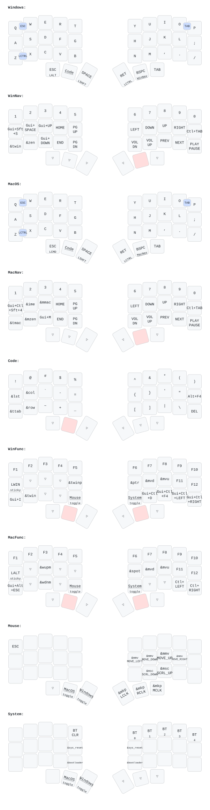

# Corne Wireless 5-Column View ZMK Config

這是給 **Corne Wireless、Nice!Nano v2** 使用的 ZMK 設定。鍵盤採用 5 列實體配置，並包含 Windows/macOS 鍵位層、導航與符號層、滑鼠控制、藍牙管理和多個快捷鍵巨集。



## 鍵位層

| 層 | 用途 |
| --- | --- |
| `WinDef` | Windows 預設 QWERTY 層；拇指鍵可輸入 Esc、Space、Enter、Backspace、Tab，並可進入 `Code` 或 `WinNav`。 |
| `WinNav` | 數字列、游標與頁面導航、音量/媒體控制，以及 Windows 快捷鍵。 |
| `MacDef` | macOS 預設 QWERTY 層，拇指修飾鍵依 macOS 調整。 |
| `MacNav` | 數字列、游標與頁面導航、音量/媒體控制，以及 macOS 快捷鍵。 |
| `Code` | 常用符號、括號、引號與 tmux 快捷鍵。 |
| `WinFunc` | Windows 功能鍵及系統快捷鍵；與 `WinNav`、`Code` 同時啟用時由 conditional layer 自動啟用。 |
| `MacFunc` | macOS 功能鍵及系統快捷鍵；與 `MacNav`、`Code` 同時啟用時由 conditional layer 自動啟用。 |
| `Mouse` | 指標移動、滾輪與滑鼠按鍵。 |
| `System` | 藍牙清除/選槽、重設與進入 bootloader，也可切換 Windows/macOS 預設層。 |

`WinDef` 與 `MacDef` 是由 `&to` 切換的基礎層。導航、Code、Mouse 等層依鍵位使用 momentary 或切換行為；詳細位置與綁定請看 `config/corne.keymap`，鍵位圖則列出各層配置。

## 巨集與組合鍵

keymap 定義了瀏覽器啟動（Zen、Edge）、終端機啟動（Windows Terminal、PowerShell、macOS Terminal）、PowerToys Run、視窗管理、截圖/錄影、Spotlight 與 tmux 操作等巨集。部分巨集依賴主機端快捷鍵和應用程式設定。

另有 `Esc`、`Tab` 和 `Ctrl` 組合鍵；它們只在 `WinDef`、`MacDef` 層生效。組合鍵位置與判定時間以 keymap 中的 combo 設定為準。

## 硬體與韌體建置

`build.yaml` 定義兩個 Nice!Nano v2 建置目標：

- `corne-left`：`corne_left` + `nice_view_adapter` + `nice_view`
- `corne-right`：`corne_right` + `nice_view_adapter` + `nice_view`

兩個目標都包含 nice!view。ZMK Studio 的 `studio-rpc-usb-uart` snippet 在 `build.yaml` 中目前是註解，`corne.conf` 中 Studio 設定也預設關閉。

此 repo 提供給 ZMK 建置流程使用的 `build.yaml`，但 repo 本身未包含 GitHub Actions workflow。若已接上能讀取此建置矩陣的 CI，請在該 CI workflow run 下載 `corne-left`、`corne-right` artifacts；否則可依下方方式本機建置。

### 本機建置

需要安裝 ZMK 所需的 west、Zephyr/SDK 工具鏈。manifest 位於 `config/west.yml`，目前指定 ZMK `v0.3`。

在 repo 根目錄初始化並更新 west workspace：

```sh
west init -l config
west update
```

建置左半部：

```sh
west build -s zmk/app -d build/left -b nice_nano_v2 -- \
  -DSHIELD="corne_left nice_view_adapter nice_view" \
  -DZMK_CONFIG="$PWD/config"
```

建置右半部：

```sh
west build -s zmk/app -d build/right -b nice_nano_v2 -- \
  -DSHIELD="corne_right nice_view_adapter nice_view" \
  -DZMK_CONFIG="$PWD/config"
```

建置產物的位置依 west/Zephyr 版本與建置設定而異；請從各 build 目錄中取出對應的 `.uf2`，並燒錄至相應半部。

## 設定檔

- `config/corne.keymap`：矩陣與實體配置選擇、9 個層、巨集、combos、hold-tap 行為及 conditional layers。
- `config/corne.conf`：藍牙連線參數、睡眠、按鍵 debounce、鍵盤名稱與 pointing 支援。鍵盤名稱為 `Corne-5`，閒置 900000 ms（15 分鐘）後睡眠。
- `config/west.yml`：west manifest，指定 ZMK `v0.3`。
- `build.yaml`：左右半部及 nice!view 的建置矩陣。
- `main.py`：呼叫 `keymap` CLI 解析 keymap 並繪製 SVG。
- `IMG/corne.svg`：產生的鍵位圖。

## 更新鍵位圖

安裝提供 `keymap` CLI 的 `keymap-drawer` 後，在 repo 根目錄執行：

```sh
python main.py
```

腳本會解析 `config/corne.keymap` 並更新 `IMG/corne.svg`，中間 YAML 檔案會在成功後刪除。

## 授權

本專案採用 MIT License，詳見 [LICENSE.md](LICENSE.md)。
